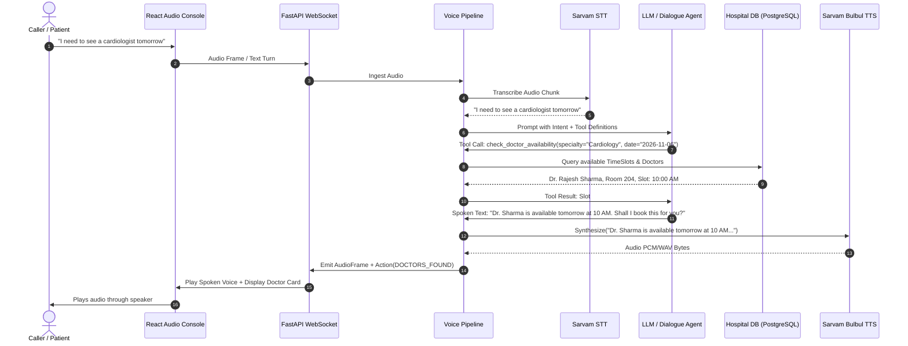
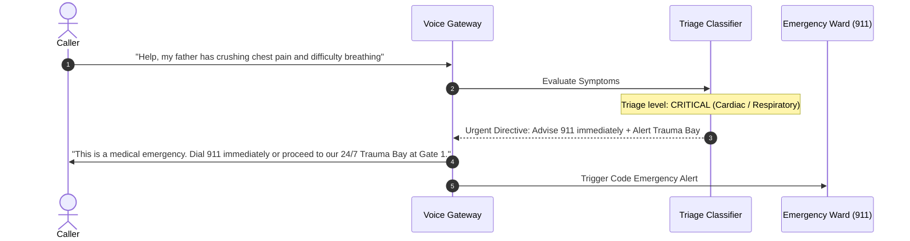

# Hospital Voice Agent - System Architecture

## 1. System Overview

The AI Hospital Receptionist & Voice Agent is a production-oriented, low-latency conversational platform designed to handle patient inquiries, check doctor schedules across clinical departments, book appointments, reschedule or cancel visits, and triage medical emergencies.

```
+-------------------------------------------------------------------------+
|                              Client Layer                               |
|   +---------------------------------+  +----------------------------+   |
|   |  Browser Client (React/Vite)    |  |  PSTN Caller (Plivo Voice) |   |
|   |  - Web Audio API / Mic Stream   |  |  - Regular Phone Call      |   |
|   |  - Real-time Audio Visualizer   |  |  - XML Voice Webhooks      |   |
|   |  - Appointments & Doctor Portal |  +-------------+--------------+   |
|   +----------------+----------------+                |                  |
+--------------------|---------------------------------|------------------+
                     | WebSocket (Binary/Frames)       | HTTP Webhook
                     v                                 v
+-------------------------------------------------------------------------+
|                           FastAPI Backend                               |
|                                                                         |
|  +-------------------------------------------------------------------+  |
|  |                 Pipecat Voice Streaming Pipeline                  |  |
|  |                                                                   |  |
|  |  +---------------+      +-------------------+      +-----------+  |  |
|  |  | STT Adapter   | ---> | Dialogue Manager  | ---> |    TTS    |  |  |
|  |  | (Sarvam / Web)|      | (LLM / Tool Call) |      | (Bulbul)  |  |  |
|  |  +---------------+      +---------+---------+      +-----+-----+  |  |
|  |                                   |                      ^        |  |
|  +-----------------------------------|----------------------|--------+  |
|                                      v                      |           |
|  +----------------------------------------------------------+--------+  |
|  |                     Hospital Business Service                     |  |
|  |  - Doctor Availability Engine                                     |  |
|  |  - Appointment Booking & Slot Reservation                         |  |
|  |  - Reschedule & Cancel Protocol                                   |  |
|  |  - Hospital Knowledge Base & 24/7 Emergency Triage Routing        |  |
|  +-----------------------------------+-------------------------------+  |
+--------------------------------------|----------------------------------+
                                       v
+-------------------------------------------------------------------------+
|                            Data & Cache Layer                           |
|  +---------------------------------+  +-------------------------------+ |
|  | PostgreSQL (or SQLite Local)    |  | Redis (or In-Memory Fallback) | |
|  | - Doctors, TimeSlots, Appts     |  | - Session Cache, Turn Locks   | |
|  | - CallLogs & Turn Transcripts   |  | - Fast FAQ Retrieval          | |
|  +---------------------------------+  +-------------------------------+ |
+-------------------------------------------------------------------------+
```

---

## 2. Voice Pipeline Architecture (Pipecat Frame Protocol)

The voice orchestrator operates on continuous, asynchronous frames:

1. **AudioRawFrame**: Incoming PCM / WAV audio packets (16 kHz, 16-bit mono) received over WebSocket from the user's browser or telephony stream.
2. **TextFrame (User)**: Emitted by the STT Adapter (Sarvam AI / SpeechRecognition).
3. **DialogueTurn / FunctionCallFrame**: Sent to the LLM dialogue provider (Gemini / OpenAI / Intelligent Rule Manager). When clinical tools are required (`check_doctor_availability`, `book_appointment`, etc.), the function executes directly against the database with transactional slot locks.
4. **TextFrame (Assistant)**: Natural language spoken response.
5. **SynthesisFrame / AudioRawFrame**: Emitted by the TTS Adapter (Sarvam Bulbul TTS) as base64-encoded audio chunks streamed back to the caller in real time.

---

## 3. Sequence Diagrams

### 3.1 Appointment Booking via Voice



### 3.2 Emergency Triage Flow



---

## 4. Key Architectural Design Choices

- **Clean Monorepo Separation**: Independent `/frontend`, `/backend`, `/infra`, and `/docs` modules.
- **Dependency Injection**: FastAPI `Depends` for all services, enabling instant mock/real adapter swapping without changing business code.
- **Graceful Zero-Cost Local Development**: Supports SQLite fallback (`sqlite+aiosqlite`), In-Memory cache fallback, and Mock voice dialogue engine so any developer or CI runner can verify 100% of the workflow without paying for external APIs or installing external databases.
- **Production Ready**: Supports PostgreSQL async connection pooling, Redis caching, structured JSON logging with correlation IDs, Docker multi-stage builds, and Nginx reverse proxying.
